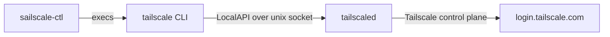

# Architecture

Sailscale wraps the official Tailscale rather than reimplementing it.
There is no resident Sailscale controller daemon.

## What exists today

| Piece | Language | Role |
|-------|----------|------|
| `tailscale/` (bundled) | — | Pin + fetch a `tailscaled`/`tailscale` build to vendor into the RPM |
| `sailscale-ctl` | Go | Short-lived control binary; execs the bundled `tailscale` CLI's local features |
| `packaging/` | — | RPM spec and the plugin `.conf` shipped by the package |

## How it fits together

- `sailscale-ctl` performs on-demand control (up/down/status/version) by exec'ing
  the bundled `tailscale` CLI's local features; it does not speak the LocalAPI
  itself and is not a service. The control socket location is therefore decided
  by tailscaled/the CLI's own defaults, not pinned by sailscale-ctl.
- Tailscale is bundled in the Sailscale RPM; `packaging/` records where its
  binaries and the plugin `.conf` are installed.